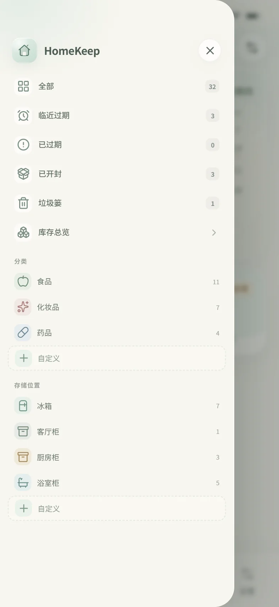
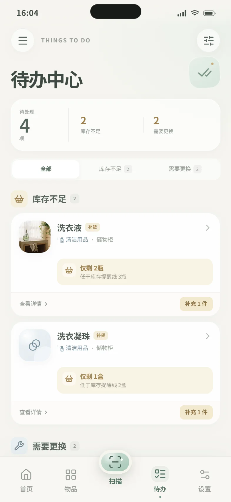
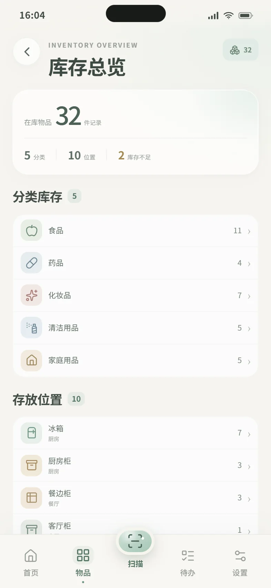
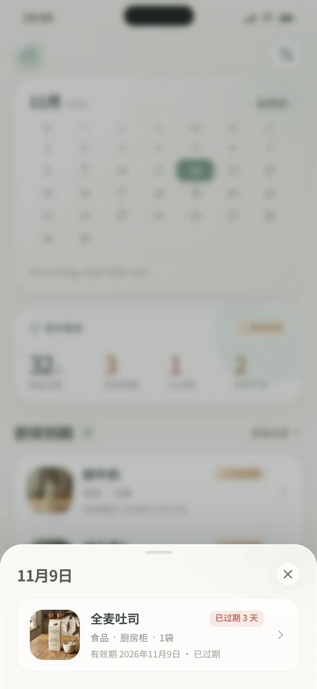
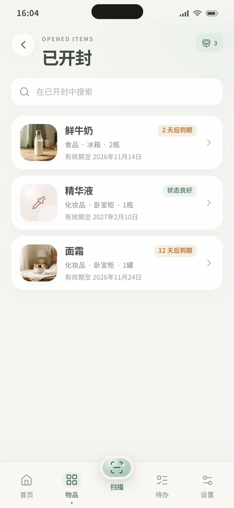
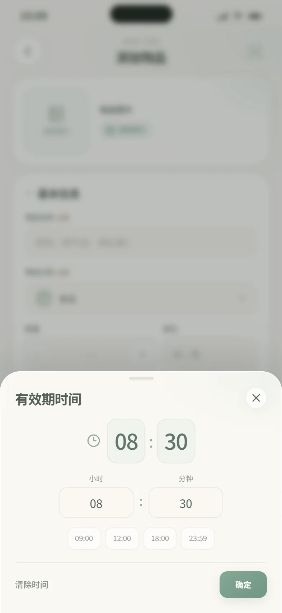

# HomeKeep · 家物管理

> Know what you have, where it is, and when it expires.

HomeKeep 是一款面向个人用户的家庭物品管理移动端 App。此仓库是一套可直接运行、可点击跳转的高保真交互原型，用于演示完整产品体验，并作为后续 React Native + Expo 开发的设计依据。

原型围绕「知道拥有什么、放在哪里、何时到期，以及自主决定如何处理过期物品」展开。界面使用半透明鼠尾草绿、暖象牙白与自然中性色，避免传统仓储软件的冷硬感。

## 在线体验

**https://lnan01089-blip.github.io/homekeep/**

无需与开发电脑连接同一网络，手机浏览器直接打开即可。推送到 `main` 分支后会自动构建并部署到 GitHub Pages。

## 本地运行

```bash
npm install
npm run dev
```

打开终端输出的本地地址（默认 `http://localhost:5173`）。

```bash
npm run build
npm run preview
```

- 建议以 iPhone 15 / 16 尺寸体验（393 × 852 或 414 × 896）。
- 桌面端会显示居中的手机模拟器；窄屏设备会直接占满屏幕。
- 页面使用应用内滚动与固定底部导航，长按/拖拽浏览器窗口可体验响应式布局。
- 首屏数据与状态均来自本地演示数据，操作会自动写入浏览器 `localStorage`。

## 页面预览

| 首页 · 月历与库存 | 侧边栏物品导航 |
| --- | --- |
|  |  |

| 我的物品 / 3D 家 | 待办中心 |
| --- | --- |
|  |  |

| 库存总览 | 物品详情 |
| --- | --- |
|  |  |

| 扫描相机 | 扫描结果确认 |
| --- | --- |
|  |  |

月历物品标记与日期详情：

已开封智能列表：

自定义有效期与时间：

更多预览位于 [`preview/`](preview/)。

## 已实现的核心体验

### 1. 首页 · 月历与库存

- 左上角三条线打开物品导航侧边栏，右上角进入设置。
- 首页只保留月历与库存：完整月历、今日高亮、星期展示；本月已过期与临近过期物品会用标记显示在对应日期。
- 点击有标记的日期，会从日期单元格向下展开气泡框，显示物品名称、存放位置和有效期；点击空白处或再次点击同一日期即可收起。
- 月历下方显示英文短句：Everything, kept with care.
- 库存区仅展示在库物品、临近过期、过期待处理、库存不足四项统计。
- 库存统计可点击：在库物品进入全部物品，临近过期进入智能列表，过期待处理进入垃圾篓，库存不足进入待办中心。
- 所有数字均由物品数据实时派生，修改任意物品后同步更新。

### 2. 侧边栏 · 物品导航

- 首页、物品、待办、设置左上角的菜单按钮可打开侧边栏，从左侧滑出并带遮罩；点击遮罩、关闭按钮或导航项后收起。
- 物品状态入口：全部、临近过期、已过期、已开封、垃圾篓、库存总览。
- 分类常用入口：食品、化妆品、药品；下方提供自定义分类创建。
- 存储位置常用入口：冰箱、客厅柜、厨房柜、浴室柜；下方提供自定义位置创建。
- “已过期”只显示用户已选择继续保留的过期物品；“垃圾篓”显示尚未处理、等待决定的过期物品。
- 自定义分类/位置会即时同步到物品表单、分类页、位置页和库存总览，并保存在本地。
- “库存总览”汇总分类、位置的物品数量和库存不足物品。

### 3. 我的物品 · 3D 全景房屋

- 独立的等距 3D 房屋插画，包含厨房、客厅、卧室、浴室与储物空间。
- 冰箱、厨房柜、餐边柜、客厅柜、电视柜、储物柜、浴室柜、衣柜、床头柜、卧室柜共 10 个可点击收纳区域。
- 家具与悬浮标签均可点击，点击时有轻微高亮反馈，再进入对应的位置物品列表。
- 每个位置展示独立物品，不混入其他位置数据。
- 右下角悬浮垃圾篓入口，显示待处理过期物品数量。
- 下方提供「全部物品」「按分类查看」「按位置查看」快捷入口。

### 4. 扫描与录入

- 全屏相机界面，使用 `navigator.mediaDevices.getUserMedia` 调用真实后置摄像头；支持权限重试、闪光灯 / 手电筒、相册导入与真实照片拍摄。
- 拍照 → 真实照片预览 → 重新拍摄 / 使用照片 → 添加物品页。
- 相机不可用或权限被拒绝时，会显示明确状态并提供重试与相册入口。
- 添加页会明确标注“演示识别结果”，只预填名称、分类和位置，不预设数量和单位，也不预设任何日期。
- 包装与效期位置各不相同，因此扫描不会自动填写有效期；请用户按实物包装自行选择日期和时间。
- 手动添加与编辑共用同一表单，字段包括：名称、分类、数量、单位、存放位置、购买日期、有效期、有效期时间、开封日期、开封后使用期限、备注。
- 数量和单位均为选填；数量可留空，单位支持自由输入任意文本。
- 表单支持完整向下滚动；日期与时间均为选填。
- 自定义日期选择器 + 自定义时间选择器，有效期时间支持逐分钟输入。
- 必须先选择有效期日期，才能选择有效期时间，避免时间被静默丢弃。
- 开封日期 + 开封后使用期限会计算建议使用截止日，可一键填入有效期，不会静默推断。
- 自定义有效期时间后，物品会在该日期和时间之后自动进入过期判定；页面会每 30 秒及重新获得焦点时刷新状态。
- 保存后自动返回物品页，并同步更新首页、分类、位置、房屋计数与提醒状态。

### 5. 分类与位置

- 基础分类：食品、化妆品、药品、清洁用品、家庭用品；侧边栏展示食品、化妆品、药品三类常用入口，并支持创建自定义分类。
- 分类总览展示物品数量、临近过期和库存不足数量。
- 分类物品页支持搜索、位置筛选、有效期排序。
- 存放位置页按房间分组，展示每处收纳的物品数量、状态与缩略图；自定义位置也会自动加入列表。
- 物品详情支持查看位置、修改位置、增减数量、编辑和删除。

### 6. 待办中心

- 待办中心只保留需要行动的库存不足与需要更换任务，避免与侧边栏的到期列表重复。
- 临近过期、已过期、已开封的浏览统一由侧边栏智能列表与首页日历承担。
- 低库存支持「补充 1 件」，补到库存提醒线后自动从待办消失。
- 更换类物品支持「标记已更换」，并重算下一次维护日期。
- 两类待办相互独立，同一件物品可以同时出现在两个模块；顶部总数按不同物品去重。
- 待办页右上角可进入通知设置；通知偏好不会再隐藏实际待办任务。

### 7. 过期物品暂存区

- 过期物品从普通列表和分类计数中自动移出，进入暂存区。
- 系统从不自动永久删除任何物品。
- 「继续保留」使物品回到普通列表，并标记为「已过期 · 已保留」；有效期和过期状态不会改变。
- 保留只对当前这一次过期有效；如果之后修改有效期，保留状态会被清除，新有效期到期后需要再次决定。
- 「彻底删除」始终经过二次确认，并同步更新过期统计与位置数据。
- 空状态、操作规则和安全提示完整实现。

### 8. 设置

- 通知开关、默认提前提醒天数、默认提醒时间。
- 日期显示格式（中文长日期 / YYYY-MM-DD / 月日短格式），会联动列表、详情和表单。
- 数据导出为 JSON 文件。
- 清空数据、恢复演示数据。
- 隐私政策、关于 HomeKeep、版本信息。

## 交互演示路径

1. **首次进入**：首页 → 月历日期 → 物品气泡 / 库存统计 → 智能列表或待办中心。
2. **浏览房屋**：物品 → 3D 房屋 → 点击冰箱 / 厨房柜 / 客厅柜等 → 位置物品列表。
3. **分类浏览**：左上角菜单 → 侧边栏 → 食品 / 化妆品 / 药品 / 自定义 → 物品详情。
4. **智能列表**：侧边栏 → 临近过期 / 已过期 / 已开封 / 垃圾篓 / 库存总览。
5. **扫描添加**：底部中央扫描 → 拍照 → 照片预览 → 使用照片 → 核对演示识别信息 → 填写日期时间 → 保存。
6. **手动添加**：物品页 / 分类页 / 位置页 → 添加物品 → 填写 → 保存。
7. **编辑物品**：物品详情 → 编辑物品 → 修改日期、数量或位置 → 保存。
8. **待办处理**：待办中心 → 补充库存 / 标记已更换；到期待览从侧边栏或日历进入。
9. **过期处理**：侧边栏垃圾篓或物品页右下角垃圾篓 → 继续保留或彻底删除（二次确认）。

## 数据规则与一致性

- 演示数据内包含 32 件普通物品和 1 件待处理过期物品。
- 「在库物品」「分类数量」「位置数量」「首页统计」均从同一份物品数据派生；暂存区物品不计入在库数量。
- `expiryDate` 与 `expiryTime` 会和当前时间比较，实时计算到期状态和剩余天数。
- 页面每 30 秒以及重新获得焦点时刷新派生状态，时间到期后无需手动刷新即可进入暂存区。
- 过期为日期/时间已到且尚未选择保留的物品；首页“过期待处理”只统计垃圾篓待处理数量。
- 用户选择“继续保留”后，物品回到普通列表并显示“已过期 · 已保留”，可在侧边栏“已过期”中查看。
- 库存不足使用每种物品独立的 `lowStockAt` 阈值；默认示例中为洗衣液与洗衣凝珠。
- 侧边栏的分类和位置为常用入口，系统仍保留其他基础分类与房屋位置；常用入口之外的内容可从全部物品、分类页、位置页和库存总览访问。
- 自定义分类/位置与物品、设置一起保存在本地，并可随数据一起导出。
- 展示日期以当天为基准动态生成，避免不同页面出现互相矛盾的到期状态。
- 原型的 `localStorage` 键为 `homekeep.prototype.v1`，在「设置 → 恢复演示数据」中可随时还原。

## 设计系统

- **背景**：`#F6F5F0`
- **浅雾绿**：`#DCE9E2`
- **半透明鼠尾草绿**：`#A9C8B8`
- **强调绿**：`#6F9682`
- **主要文字**：`#424D47`
- **次要文字**：`#89918A`
- **卡片**：`#FFFFFF`
- **浅米色**：`#F1EDE2`
- **状态色**：已过期柔和红、临近过期暖橙、正常浅绿、库存不足柔和黄、需要更换灰蓝
- 统一 18–30px 圆角、轻阴影、玻璃质感卡片、底部固定五栏导航与中央扫描快捷按钮。

## 代码结构

```text
src/
├── App.jsx                    # 应用外壳、状态栏、底部导航与路由渲染
├── store.jsx                  # 数据、设置、导航栈、派生状态与持久化
├── data.js                    # 演示数据、分类 / 位置、日期与格式化工具
├── styles.css                 # 完整视觉系统与响应式样式
├── components/
│   ├── ui.jsx                 # 通用 UI、弹层、日期选择器、Toast 等
│   ├── Sidebar.jsx            # 左侧物品导航、自定义分类/位置
│   └── HouseScene.jsx         # 独立 3D 全景房屋插画与可点击热区
├── pages/
│   ├── Home.jsx
│   ├── Items.jsx
│   ├── Categories.jsx
│   ├── CategoryDetail.jsx
│   ├── Locations.jsx
│   ├── LocationDetail.jsx
│   ├── AllItems.jsx
│   ├── ItemDetail.jsx
│   ├── ItemForm.jsx
│   ├── SmartList.jsx          # 临近过期 / 已过期 / 已开封智能列表
│   ├── InventoryOverview.jsx  # 库存总览
│   ├── Scan.jsx
│   ├── Tasks.jsx              # 待办中心：补货与更换
│   ├── ReminderSettings.jsx   # 通知偏好
│   ├── Trash.jsx
│   ├── Settings.jsx
│   └── InfoPage.jsx
└── assets/products/           # 本地物品图片素材
```

## 面向 React Native + Expo 的落地建议

- **导航**：使用 Expo Router / React Navigation。底部 Tab 对应「首页、物品、待办、设置」，中央扫描做成自定义 Tab Button 或模态全屏路由；左右滑出的 Sidebar 承担全部物品、分类、位置和智能列表导航。
- **状态层**：保留 `store.jsx` 的派生逻辑，迁移到 Zustand / Context 均可。核心选择器（`isSoon`、`isTrash`、`isLowStock`、`statusFor`）建议抽成独立领域模块，保证智能列表、待办、详情共享同一判定；自定义分类/位置应迁移到 SQLite 并与物品表建立外键。
- **房屋地图**：`HouseScene.jsx` 可由 `react-native-svg` 直接承载 SVG；每个 `<Zone>` 映射为 SVG `G` + `Pressable` / 透明热区。若运行性能不足，可将 SVG 静态化，再用绝对定位透明的 `Pressable` 覆盖家具。悬浮标签即绝对定位的 Pressable。
- **相机与识别**：Web 原型已通过 `getUserMedia` 使用真实后置摄像头；原生端使用 `expo-camera` 重写取景、拍摄与手电筒逻辑，并保留权限拒绝与相册回退。识别业务可抽象为 `recognizeInventoryPhoto(uri)`，当前返回预置结果，后续可接入真实 OCR。
- **本地数据**：Web 原型使用 `localStorage`；原生版建议 `expo-sqlite` 保存物品和设置，导出使用 `expo-file-system` + `expo-sharing`。
- **待办与通知**：接入 `expo-notifications`，在新建 / 编辑物品或修改提前天数时重新注册本地通知。当前原型将日期浏览放在侧边栏和日历，待办中心只保留补货与更换动作。
- **动效**：现有页面切换、抽屉、扫描线和照片流程可作为交互参考，原生可使用 Reanimated 实现。

## 原型说明

- 相机为真实摄像头画面；扫描后的物品信息识别仍为原型模拟，不包含真实 OCR、后端、账户或云端同步。
- 浏览器要求相机运行在 HTTPS 或 localhost 环境。GitHub Pages 已启用 HTTPS，可直接在手机浏览器授权使用相机。
- 这是产品体验原型，而非生产版本。日期、通知权限、空数据恢复等边界行为已为首版演示做了简化。
