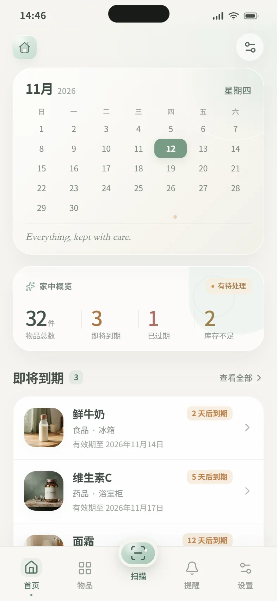
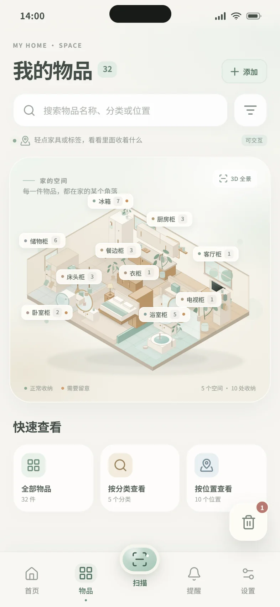
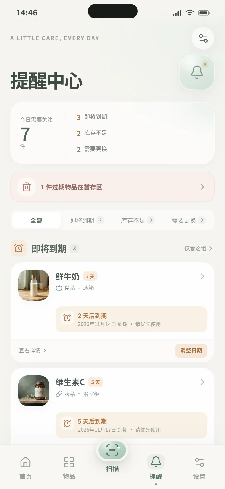
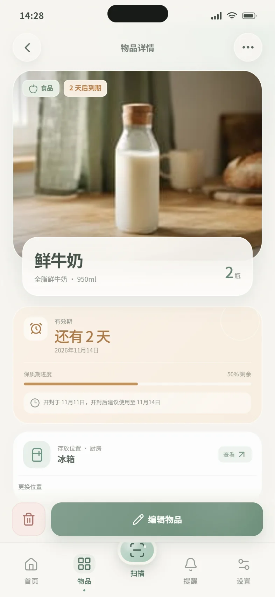
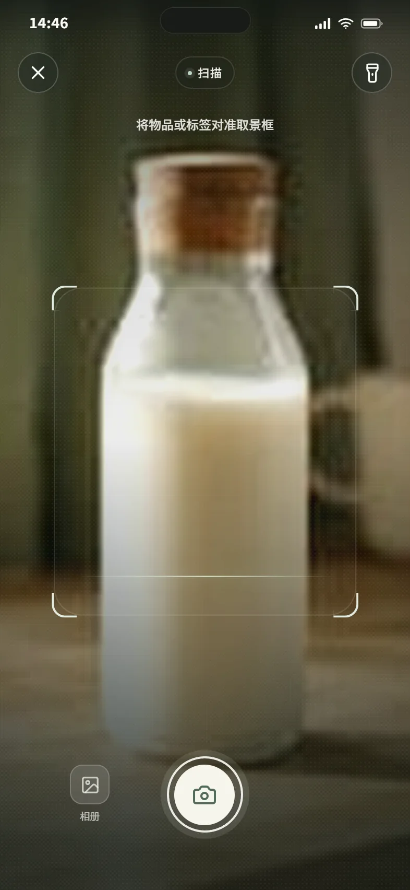
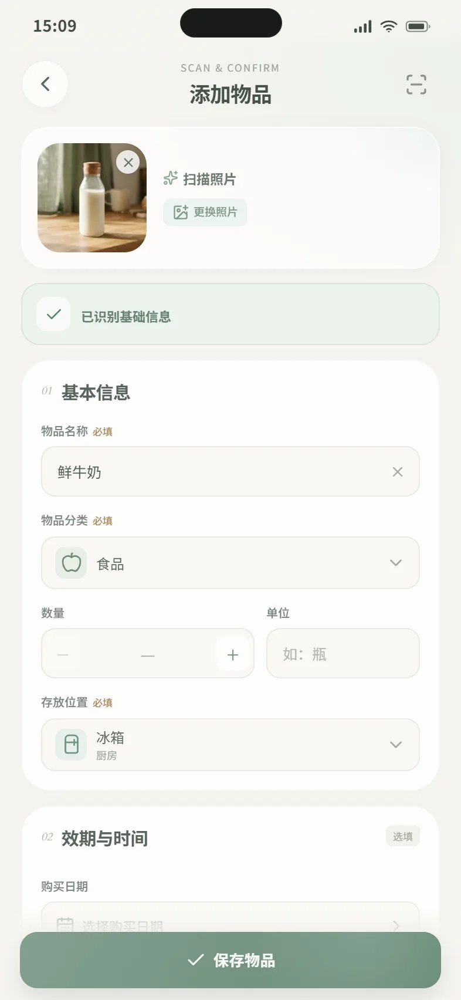

# HomeKeep · 家物管理

> Know what you have, where it is, and when it expires.

HomeKeep 是一款面向个人用户的家庭物品管理移动端 App。此仓库是一套可直接运行、可点击跳转的高保真交互原型，用于演示完整产品体验，并作为后续 React Native + Expo 开发的设计依据。

原型围绕「知道拥有什么、放在哪里、何时到期，以及自主决定如何处理过期物品」展开。界面使用半透明鼠尾草绿、暖象牙白与自然中性色，避免传统仓储软件的冷硬感。

## 在线体验

**https://lnan01089-blip.github.io/homekeep/**

无需与开发电脑连接同一网络，手机浏览器直接打开即可。推送到 `main` 分支后会自动构建并部署到 GitHub Pages。

## 本地运行

```bash
npm install
npm run dev
```

打开终端输出的本地地址（默认 `http://localhost:5173`）。

```bash
npm run build
npm run preview
```

- 建议以 iPhone 15 / 16 尺寸体验（393 × 852 或 414 × 896）。
- 桌面端会显示居中的手机模拟器；窄屏设备会直接占满屏幕。
- 页面使用应用内滚动与固定底部导航，长按/拖拽浏览器窗口可体验响应式布局。
- 首屏数据与状态均来自本地演示数据，操作会自动写入浏览器 `localStorage`。

## 页面预览

| 首页 | 我的物品 / 3D 家 |
| --- | --- |
|  |  |

| 提醒中心 | 物品详情 |
| --- | --- |
|  |  |

| 扫描相机 | 扫描结果确认 |
| --- | --- |
|  |  |

更多预览位于 [`preview/`](preview/)。

## 已实现的核心体验

### 1. 首页 · 月历

- 完整月历、今日高亮、星期展示与设置入口；月历下方为英文短句。
- 32 件物品、3 件即将到期、1 件已过期、2 件库存不足的概览统计。
- 统计项可点击，分别进入全部物品、到期提醒、过期暂存区和库存提醒。
- 即将到期物品列表、分类入口与「添加物品」主操作。
- 所有数字均由物品数据实时派生，修改任意物品后同步更新。

### 2. 我的物品 · 3D 全景房屋

- 独立的等距 3D 房屋插画，包含厨房、客厅、卧室、浴室与储物空间。
- 冰箱、厨房柜、餐边柜、客厅柜、电视柜、储物柜、浴室柜、衣柜、床头柜、卧室柜共 10 个可点击收纳区域。
- 家具与悬浮标签均可点击，点击时有轻微高亮反馈，再进入对应的位置物品列表。
- 每个位置展示独立物品，不混入其他位置数据。
- 右下角悬浮垃圾篓入口，显示待处理过期物品数量。
- 下方提供「全部物品」「按分类查看」「按位置查看」快捷入口。

### 3. 扫描与录入

- 全屏相机界面，使用 `navigator.mediaDevices.getUserMedia` 调用真实后置摄像头；支持权限重试、闪光灯 / 手电筒、相册导入与真实照片拍摄。
- 拍照 → 真实照片预览 → 重新拍摄 / 使用照片 → 添加物品页。
- 相机不可用或权限被拒绝时，会显示明确状态并提供重试与相册入口。
- 添加页显示模拟识别结果，只预填名称、分类、数量、单位和位置，不预设任何日期。
- 包装与效期位置各不相同，因此扫描不会自动填写有效期；请用户按实物包装自行选择日期。
- 手动添加与编辑共用同一表单，覆盖 10 个字段：
  名称、分类、数量、单位、存放位置、购买日期、有效期、开封日期、开封后使用期限、备注。
- 自定义日期选择器；所有日期均为选填。
- 开封日期 + 开封后使用期限会计算建议使用截止日，可一键填入有效期，不会静默推断。
- 保存后自动返回物品页，并同步更新首页、分类、位置、房屋计数与提醒状态。

### 4. 分类与位置

- 五个分类：食品、药品、美妆护肤、清洁用品、家庭用品。
- 分类总览展示物品数量、即将到期和库存不足数量。
- 分类物品页支持搜索、位置筛选、有效期排序。
- 存放位置页按房间分组，展示每处收纳的物品数量、状态与缩略图。
- 物品详情支持查看位置、修改位置、增减数量、编辑和删除。

### 5. 提醒中心

- 三个提醒模块：即将到期、库存不足、需要更换。
- 单独提醒筛选、按类型计数、查看详情与快捷处理。
- 低库存支持「补充 1 件」，补到阈值后自动从提醒中消失。
- 更换类物品支持「标记已更换」，并重算下一次维护日期。
- 过期物品不在提醒中心重复展示，通过顶部横幅统一进入暂存区。
- 提醒总开关、分类开关、提前天数与默认提醒时间均可配置。

### 6. 过期物品暂存区

- 过期物品从普通列表和分类计数中自动移出，进入暂存区。
- 系统从不自动永久删除任何物品。
- 「继续保留」使物品回到普通列表，并标记为「已过期 · 已保留」；有效期和过期状态不会改变。
- 「彻底删除」始终经过二次确认，并同步更新过期统计与位置数据。
- 空状态、操作规则和安全提示完整实现。

### 7. 设置

- 通知开关、默认提前提醒天数、默认提醒时间。
- 日期显示格式（中文长日期 / YYYY-MM-DD / 月日短格式），会联动列表、详情和表单。
- 数据导出为 JSON 文件。
- 清空数据、恢复演示数据。
- 隐私政策、关于 HomeKeep、版本信息。

## 交互演示路径

1. **首次进入**：首页 → 概览统计 → 即将到期物品 → 物品详情。
2. **浏览房屋**：物品 → 3D 房屋 → 点击冰箱 / 厨房柜 / 客厅柜等 → 位置物品列表。
3. **分类浏览**：首页 → 物品分类 → 食品 → 某项物品 → 物品详情。
4. **扫描添加**：底部中央扫描 → 拍照 → 照片预览 → 使用照片 → 确认识别信息 → 保存。
5. **手动添加**：首页 / 物品页 / 分类页 → 添加物品 → 填写 → 保存。
6. **编辑物品**：物品详情 → 编辑物品 → 修改日期、数量或位置 → 保存。
7. **提醒处理**：提醒中心 → 调整日期 / 补充库存 / 标记已更换。
8. **过期处理**：物品页右下角垃圾篓 → 继续保留或彻底删除（二次确认）。

## 数据规则与一致性

- 演示数据内包含 32 件普通物品和 1 件待处理过期物品。
- 「物品总数」「分类数量」「位置数量」「首页统计」均从同一份物品数据派生。
- `expiryDate` 与当前日期比较，实时计算到期状态和剩余天数。
- 过期为日期早于今天且尚未选择保留的物品；过期统计会包含暂存区与已保留的过期物品。
- 库存不足使用每种物品独立的 `lowStockAt` 阈值；默认示例中为洗衣液与洗衣凝珠。
- 展示日期以当天为基准动态生成，避免不同页面出现互相矛盾的到期状态。
- 原型的 `localStorage` 键为 `homekeep.prototype.v1`，在「设置 → 恢复演示数据」中可随时还原。

## 设计系统

- **背景**：`#F6F5F0`
- **浅雾绿**：`#DCE9E2`
- **半透明鼠尾草绿**：`#A9C8B8`
- **强调绿**：`#6F9682`
- **主要文字**：`#424D47`
- **次要文字**：`#89918A`
- **卡片**：`#FFFFFF`
- **浅米色**：`#F1EDE2`
- **状态色**：已过期柔和红、即将到期暖橙、正常浅绿、库存不足柔和黄、需要更换灰蓝
- 统一 18–30px 圆角、轻阴影、玻璃质感卡片、底部固定五栏导航与中央扫描快捷按钮。

## 代码结构

```text
src/
├── App.jsx                    # 应用外壳、状态栏、底部导航与路由渲染
├── store.jsx                  # 数据、设置、导航栈、派生状态与持久化
├── data.js                    # 演示数据、分类 / 位置、日期与格式化工具
├── styles.css                 # 完整视觉系统与响应式样式
├── components/
│   ├── ui.jsx                 # 通用 UI、弹层、日期选择器、Toast 等
│   └── HouseScene.jsx         # 独立 3D 全景房屋插画与可点击热区
├── pages/
│   ├── Home.jsx
│   ├── Items.jsx
│   ├── Categories.jsx
│   ├── CategoryDetail.jsx
│   ├── Locations.jsx
│   ├── LocationDetail.jsx
│   ├── AllItems.jsx
│   ├── ItemDetail.jsx
│   ├── ItemForm.jsx
│   ├── Scan.jsx
│   ├── Reminders.jsx
│   ├── ReminderSettings.jsx
│   ├── Trash.jsx
│   ├── Settings.jsx
│   └── InfoPage.jsx
└── assets/products/           # 本地物品图片素材
```

## 面向 React Native + Expo 的落地建议

- **导航**：使用 Expo Router / React Navigation。主 Tab 对应「首页、物品、提醒、设置」，中央扫描做成自定义 Tab Button 或模态全屏路由；其余二级页面放入 Stack。
- **状态层**：保留 `store.jsx` 的派生逻辑，迁移到 Zustand / Context 均可。核心选择器（`isSoon`、`isTrash`、`isLowStock`、`statusFor`）建议抽成独立领域模块，保证列表、提醒、详情共享同一判定。
- **房屋地图**：`HouseScene.jsx` 可由 `react-native-svg` 直接承载 SVG；每个 `<Zone>` 映射为 SVG `G` + `Pressable` / 透明热区。若运行性能不足，可将 SVG 静态化，再用绝对定位透明的 `Pressable` 覆盖家具。悬浮标签即绝对定位的 Pressable。
- **相机与识别**：Web 原型已通过 `getUserMedia` 使用真实后置摄像头；原生端使用 `expo-camera` 重写取景、拍摄与手电筒逻辑，并保留权限拒绝与相册回退。识别业务可抽象为 `recognizeInventoryPhoto(uri)`，当前返回预置结果，后续可接入真实 OCR。
- **本地数据**：Web 原型使用 `localStorage`；原生版建议 `expo-sqlite` 保存物品和设置，导出使用 `expo-file-system` + `expo-sharing`。
- **提醒**：接入 `expo-notifications`，在新建 / 编辑物品或修改提前天数时重新注册本地通知。当前原型的提醒列表由日期与设置实时派生。
- **动效**：现有页面切换、抽屉、扫描线和照片流程可作为交互参考，原生可使用 Reanimated 实现。

## 原型说明

- 相机为真实摄像头画面；扫描后的物品信息识别仍为原型模拟，不包含真实 OCR、后端、账户或云端同步。
- 浏览器要求相机运行在 HTTPS 或 localhost 环境。GitHub Pages 已启用 HTTPS，可直接在手机浏览器授权使用相机。
- 这是产品体验原型，而非生产版本。日期、通知权限、空数据恢复等边界行为已为首版演示做了简化。
